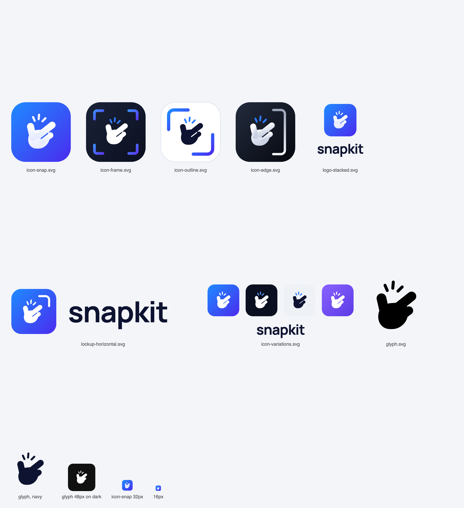

# Snapkit brand

The snapping hand, drawn as SVG. Everything is generated from one definition of the hand in
[`build.mjs`](build.mjs), so a change to the glyph shows up in every file:

```bash
node branding/build.mjs
```

| File | What |
|---|---|
| `icon-snap.svg` | 1. The Snap: blue gradient tile, white hand (the main app icon) |
| `icon-frame.svg` | 2. Screenshot Frame: dark tile, crop corners |
| `icon-outline.svg` | 3. Minimal Outline: light tile, two corner brackets, navy hand |
| `lockup-horizontal.svg` | 4. Horizontal lockup: icon + wordmark |
| `icon-edge.svg` | 5. Edge Capture: dark tile, light edge on the right |
| `icon-variations.svg` | 6. Color variations: blue, dark, light, purple + wordmark |
| `logo-stacked.svg` | Icon above the wordmark |
| `glyph.svg` | The hand alone in `currentColor`, for UI and favicons (inline it to set the color) |



Notes:

- The wordmark is live text, not outlines: it asks for Plus Jakarta Sans / Manrope / Inter and falls back to the
  system font. Before printing or uploading it somewhere that won't have the font, convert it to outlines in a
  design tool.
- Gradient ids are prefixed with the file name, so several of these SVGs can be inlined on one page.
